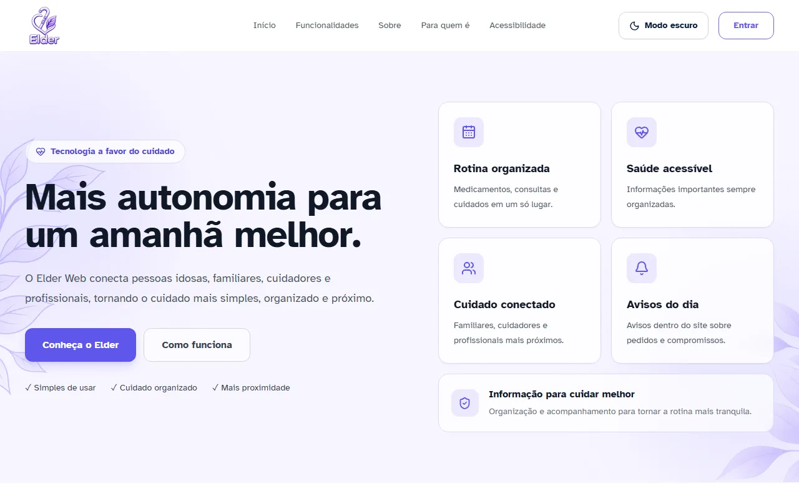
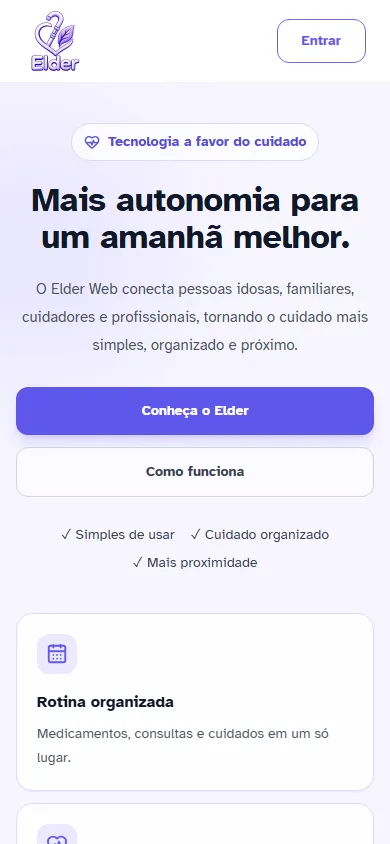
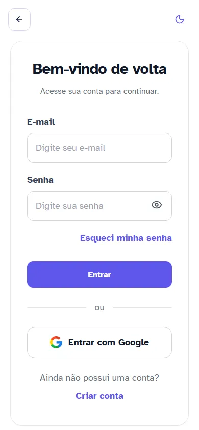

<div align="center">


# Elder Web

**Saúde, remédios, agenda e alimentação do idoso em um só lugar, compartilhados com quem cuida.**

Trabalho de Conclusão de Curso (TCC) · Curso Técnico em Desenvolvimento de Sistemas · Etec Fernando Prestes · 2026

[](https://github.com/MixuriM/Elder_Web/actions/workflows/ci.yml)


[Demonstração](https://elder-web.vercel.app) · [Funcionalidades](#funcionalidades) · [Perfis e permissões](#perfis-vínculos-e-permissões) · [Arquitetura](#arquitetura) · [Modelo de dados](#modelo-de-dados) · [Como executar](#como-executar-localmente) · [Testes](#testes-e-qualidade)

</div>

## Sobre o projeto

O cuidado de uma pessoa idosa costuma ficar espalhado: o idoso, a família e o cuidador anotam remédios, consultas e medições em lugares diferentes, e ninguém enxerga o quadro inteiro. O Elder Web é uma aplicação web que reúne esse registro e o compartilha com as pessoas certas, com permissões claras sobre quem pode ver e quem pode alterar cada coisa.

As contas são organizadas em três perfis:

| Perfil | Quem é | O que faz |
|---|---|---|
| Idoso | Quem recebe o cuidado | Registra saúde, remédios, agenda e alimentação, decide quem se vincula a ele, dispara o aviso de emergência |
| Cuidador | Profissional ou pessoa que cuida | Depois de vinculado e aprovado, consulta os dados do idoso e registra o que o idoso ou a família liberaram |
| Familiar | Parente ou responsável | Acompanha o idoso, pode cadastrar a conta de um idoso e, conforme o modo de decisão, registrar e gerir vínculos |

A interface do idoso prioriza acessibilidade acima de qualquer outra preocupação de design (veja [Acessibilidade](#acessibilidade)).

Demonstração do frontend: <https://elder-web.vercel.app>

> [!NOTE]
> O backend roda no plano gratuito do Render. Na primeira requisição depois de um período sem uso, o login e o cadastro podem demorar alguns segundos.

## Funcionalidades

Legenda: ✅ concluído, 🟡 parcial, ⏳ pendente.

| Módulo | O que oferece | Perfis | Status |
|---|---|---|---|
| Autenticação e cadastro | Cadastro e login por e-mail e senha ou Google, recuperação de senha, confirmação de e-mail, perfil escolhido no cadastro | Todos | ✅ |
| Vínculos e permissões | Solicitação, convite, aprovação, recusa e contestação de vínculo; 3 permissões do cuidador; modo de decisão | Todos | ✅ |
| Cadastro de idoso pelo familiar | O familiar cria a conta do idoso, com termo de responsabilidade | Familiar | ✅ |
| Saúde | Registro e edição de medições (pressão, por exemplo), com autoria de quem registrou e de quem editou | Todos | ✅ |
| Remédios e doses | Cadastro de medicamentos, marcação de doses (administrada, pulada, atrasada) e histórico | Todos | ✅ |
| Histórico em PDF | Download do histórico de saúde e de remédios | Todos | ✅ |
| Agenda | Compromissos pessoais, médicos e de cuidado, em calendário (mês e dia) e em lista, no fuso de Brasília | Todos | ✅ |
| Alimentação | Registro de refeições e histórico | Todos | ✅ |
| Aviso de emergência | Botão no cabeçalho do idoso que envia e-mail aos vínculos aprovados com e-mail confirmado, e atalho para ligar 192 | Idoso | ✅ |
| Perfil e foto | Dados da conta, situação do e-mail e foto de perfil (inclusive HEIC de iPhone, convertida no navegador) | Todos | ✅ |
| Avisos | Pedidos de vínculo a responder e compromissos de hoje e de amanhã, exibidos só dentro do site | Todos | ✅ |
| Configurações | Tema claro, escuro ou do sistema; tamanho do texto; menos movimento; modo de decisão; conta | Todos | ✅ |
| Orientações | Página de orientações gerais, para quem está logado | Todos | 🟡 |
| Sobre Nós | Página pública sobre o projeto | Visitante | 🟡 |

As duas páginas marcadas com 🟡 funcionam, mas o texto final ainda está em revisão pela equipe.

## Telas

Páginas públicas, sem dado real.

<p align="center">
  
</p>
<p align="center">
  
  &nbsp;&nbsp;
  
</p>

## Perfis, vínculos e permissões

Um cuidador só acessa as ferramentas do idoso depois de vinculado formalmente a ele. O vínculo é uma tabela genérica (`Vinculo`) que cobre cuidador e familiar, e a relação com o idoso é N:N.

**Como o vínculo nasce e é aprovado**

| Origem | Quem inicia | Aprovação |
|---|---|---|
| `solicitacao_cuidador` | Cuidador | Manual |
| `convite_idoso` (cuidador) | Idoso, para um cuidador que já tem conta | O cuidador aceita, com e-mail confirmado, em até 7 dias |
| `solicitacao_familiar` | Familiar | Manual |
| `convite_idoso` (familiar) | Idoso, pelo e-mail do familiar | Automática, quando o familiar confirma a posse do e-mail |
| `cadastro_familiar` | Familiar que cadastra o idoso | Automática, quando o familiar confirma a posse do e-mail |

**Quem decide.** Aprovar, recusar ou contestar um vínculo, e ligar as permissões do cuidador, cabe a quem o campo `Usuario.modo_decisao` do idoso indica: o próprio idoso (`idoso`) ou os familiares com vínculo aprovado (`familiar`). Nunca os dois em paralelo. O idoso pode voltar a decidir sozinho a qualquer momento. Passar a decisão para o familiar passa por uma carência de 7 dias e, havendo mais de um familiar, por uma segunda confirmação.

**Permissões do cuidador.** Cada vínculo de cuidador tem 3 flags, todas desligadas ao nascer: `permite_registrar_saude`, `permite_marcar_dose` e `permite_criar_evento_cuidado`. O cuidador só consulta remédios e alimentação: não cadastra medicamento nem refeição, mas pode marcar doses quando `permite_marcar_dose` estiver ligada.

**Quem pode ler e quem pode escrever** (a partir de `ROTAS_ESPERADAS` e das regras de ator do backend):

| Módulo | Idoso | Cuidador vinculado | Familiar vinculado |
|---|---|---|---|
| Saúde | Lê, registra e edita | Lê; registra e edita só com `permite_registrar_saude` | Lê; registra e edita só com modo de decisão `familiar` |
| Remédios | Lê e cadastra | Lê; nunca cadastra | Lê; cadastra só com modo de decisão `familiar` |
| Doses | Marca | Marca só com `permite_marcar_dose` | Marca só com modo de decisão `familiar` |
| Histórico em PDF | Baixa o próprio | Baixa, com vínculo aprovado | Baixa, com vínculo aprovado |
| Agenda | Lê e cria compromissos pessoais e médicos | Lê; cria só compromissos de cuidado, com `permite_criar_evento_cuidado` | Lê; cria só compromissos pessoais e médicos, com modo de decisão `familiar` |
| Alimentação | Lê e registra | Lê; nunca registra | Lê; registra só com modo de decisão `familiar` |
| Aviso de emergência | Dispara | Não | Não |

## Arquitetura

<p align="center">
  
</p>

<p align="center">
  
</p>

- O frontend é uma aplicação multipágina (React Router), publicada na Vercel.
- O Firebase Auth só autentica. Todos os dados de domínio ficam no SQL Server.
- O `firebase_uid` é uma coluna única de `Usuario`, nunca chave primária: o resto do banco referencia `Usuario.id`, e a dependência do Firebase fica isolada em uma coluna.
- Um middleware valida o ID Token em cada requisição autenticada e resolve o id interno do usuário.
- O envio de e-mail é a única integração externa além do Firebase, e só o aviso de emergência a usa.

## Modelo de dados

São 7 entidades. O schema do Prisma (`backend/prisma/schema.prisma`) é a fonte única do modelo, e o documento [Modelagem ER](docs/Elder%20Web%20-%20Modelagem%20ER.md) traz todos os atributos, relacionamentos e decisões. O diagrama mostra só as chaves e os campos principais.

<p align="center">
  
</p>

`Evento`, `Medicamento`, `RegistroSaude` e `RegistroAlimentar` também guardam quem editou (`editado_por_id`), obrigatório em `RegistroSaude`. Os valores de negócio (por exemplo `tipo_perfil` e `status`) são texto no banco, com restrições `CHECK` escritas nas migrations, porque o conector do SQL Server não suporta `enum`.

## Tecnologias

Versões principais, conforme os `package.json`.

| Camada | Tecnologia | Para quê |
|---|---|---|
| Frontend | React 18, TypeScript 5, Vite 6 | Interface e build |
| Frontend | Tailwind CSS 3 | Estilo utility-first |
| Frontend | React Router 7 | Navegação multipágina |
| Frontend | Firebase Web SDK 12 | Login |
| Frontend | lucide-react 1, heic-to 1 | Ícones e conversão de foto HEIC no navegador |
| Frontend | Atkinson Hyperlegible (em `frontend/public/fonts`, licença OFL) | Fonte legível, hospedada no próprio site |
| Backend | Node.js 24, Express 4, TypeScript 5 | API REST |
| Backend | Prisma 5 | ORM e migrations |
| Backend | firebase-admin 14 | Validação do ID Token |
| Backend | multer 2, sharp 0.35 | Upload e normalização da foto |
| Backend | pdfkit 0.20 | PDF do histórico |
| Banco | SQL Server 2025 (local), Azure SQL Database (produção) | Dados de domínio |
| Autenticação | Firebase Auth (e-mail e senha, Google) | Só login |
| Testes | Jest 30, React Testing Library 16, jest-axe 11 | Unidade, componente e acessibilidade |
| Testes | Playwright 1, @axe-core/playwright 4 | Ponta a ponta, acessibilidade e responsividade |
| Infra | Docker, GitHub Actions, Vercel, Render, Azure | Build, CI e deploy |

## Acessibilidade

Para o público idoso, acessibilidade é requisito central, não acabamento.

- **Legibilidade:** fonte Atkinson Hyperlegible hospedada no próprio site, cores com contraste auditado e opção de tema escuro.
- **Preferências do usuário:** tamanho do texto normal, grande ou muito grande, tema claro, escuro ou do sistema, e opção de reduzir movimento, tudo em Configurações.
- **Toque:** alvos de 44 por 44 px com 8 px livres entre eles e campos com fonte de 16 px.
- **Celular:** layout pensado a partir de 320 px de largura, sem rolagem horizontal.
- **Semântica:** HTML semântico e ARIA (`role="status"`, `role="alert"`, `role="switch"`), com feedback claro depois de cada ação.
- **Auditoria automática:** testes com `jest-axe` nas telas e `@axe-core/playwright` nas rotas completas, com contraste ligado, falhando em violações `critical` e `serious`.
- **Responsividade:** teste de layout no celular (`npm run test:responsivo`) que mede estouro, tamanho de alvo e de fonte.

## Segurança e privacidade

> [!IMPORTANT]
> Registros de saúde e medicamentos são dados sensíveis. Nenhum log, corpo de erro ou mensagem de erro carrega esses valores.

- **Identidade:** o ID Token do Firebase é validado no servidor com o Firebase Admin SDK em toda rota autenticada.
- **Autorização por vínculo, no servidor:** o acesso aos dados de um idoso só passa com vínculo aprovado do usuário com aquele idoso, verificado a cada requisição. O idoso consultado vem do vínculo, e a autoria dos registros nunca vem do corpo da requisição.
- **Permissões:** quem pode escrever depende do perfil, do `modo_decisao` do idoso e das flags do cuidador, sempre lidos no servidor.
- **Sem vazamento por resposta:** registro inexistente e registro de outro idoso respondem o mesmo 404, e os 403 não revelam a regra que barrou.
- **Logs:** o tratador de erros registra só nome, código, método e caminho, nunca mensagem, pilha, corpo nem parâmetros.
- **Vínculo automático:** só vale com a posse do e-mail confirmada, e o e-mail do token precisa ser o mesmo do cadastro.
- **Transporte e repouso:** HSTS em produção, TLS na hospedagem, conexão com o banco criptografada e validada, e criptografia em repouso (TDE) no Azure SQL.
- **Entradas:** valores de requisição só entram em consultas do Prisma depois de checagem de tipo, e um teste barra SQL cru no código.
- **Foto de perfil:** validada pelos bytes (não pelo tipo declarado), reencodada em WebP de até 1024 px sem metadados EXIF, com limite de tamanho e de envios por hora.
- **Aviso de emergência:** só o idoso dispara, com limite de tentativas por hora.
- **Autorização no CI:** a suíte `backend/src/routes/autorizacaoRotas.test.ts` compara as rotas reais do app com uma lista classificada. Rota nova sem classificação derruba o CI.

## Como executar localmente

**Pré-requisitos**

- Node.js 24 (versão do `.nvmrc`)
- Docker, para o SQL Server local
- Um projeto Firebase seu, com Authentication por e-mail e senha e por Google, e uma conta de serviço (chave privada) para o backend

**Passos**

1. Clone o repositório e entre nele.

   ```bash
   git clone https://github.com/MixuriM/Elder_Web.git
   cd Elder_Web
   ```

2. Copie os arquivos de exemplo e preencha os valores (no PowerShell, use `Copy-Item`).

   ```bash
   cp .env.example .env
   cp backend/.env.example backend/.env
   cp frontend/.env.example frontend/.env
   ```

   No `.env` da raiz, defina `MSSQL_SA_PASSWORD`. No `backend/.env`, ajuste `DATABASE_URL` (host `localhost`, porta `14330`, banco `elder_web`, usuário `sa` e a mesma senha) e as variáveis `FIREBASE_*`. No `frontend/.env`, preencha as `VITE_FIREBASE_*`. Todas as variáveis estão listadas abaixo.

3. Suba o SQL Server local (serviço `db`, porta `14330`).

   ```bash
   docker compose up -d db
   ```

4. Instale as dependências e aplique as migrations, de dentro de `backend/`. O `migrate deploy` cria o banco `elder_web` se ele ainda não existir.

   ```bash
   cd backend
   npm ci
   npx prisma migrate deploy
   ```

5. Suba o backend (porta 3000) e, em outro terminal, o frontend (porta 5173).

   ```bash
   # em backend/
   npm run dev
   # em frontend/ (rode npm ci antes na primeira vez)
   npm run dev
   ```

6. Abra <http://localhost:5173>.

> [!WARNING]
> Nunca aponte `DATABASE_URL` para um banco que não seja o seu ao rodar migrations ou os scripts `backend/scripts/verify-*`. Use `migrate deploy`, não `migrate dev`: o Azure SQL recusa criar o shadow database.

<details>
<summary>Variáveis de ambiente (só os nomes)</summary>

| Arquivo | Variável | Para quê |
|---|---|---|
| `.env` (raiz) | `MSSQL_SA_PASSWORD` | Senha do usuário `sa` do SQL Server do `docker-compose.yml` |
| `backend/.env` | `DATABASE_URL` | Conexão do Prisma com o SQL Server |
| `backend/.env` | `PORT` | Porta da API |
| `backend/.env` | `FRONTEND_URL` | Origem liberada no CORS |
| `backend/.env` | `FIREBASE_PROJECT_ID`, `FIREBASE_CLIENT_EMAIL`, `FIREBASE_PRIVATE_KEY` | Conta de serviço do Firebase Admin SDK |
| `backend/.env` | `EMAIL_API_KEY`, `EMAIL_REMETENTE_NOME`, `EMAIL_REMETENTE_ENDERECO` | E-mail do aviso de emergência (sem elas, só esse aviso responde 503) |
| `backend/.env` | `NODE_ENV` | `production` ativa o HSTS (só no deploy) |
| `frontend/.env` | `VITE_API_URL` | Endereço da API |
| `frontend/.env` | `VITE_FIREBASE_API_KEY`, `VITE_FIREBASE_AUTH_DOMAIN`, `VITE_FIREBASE_PROJECT_ID`, `VITE_FIREBASE_STORAGE_BUCKET`, `VITE_FIREBASE_MESSAGING_SENDER_ID`, `VITE_FIREBASE_APP_ID` | Configuração do Firebase Web SDK |

</details>

## Testes e qualidade

| Comando | O que cobre | Onde roda | Pré-requisitos |
|---|---|---|---|
| `npm test` em `backend/` | 55 suítes e 2862 testes (Jest, Prisma e Firebase simulados) | Local | Nenhum |
| `npm run test:coverage` em `backend/` | Os mesmos testes, com limiares de cobertura | CI | Nenhum |
| `npm test` em `frontend/` | 106 suítes e 1167 testes (Jest, Testing Library, jest-axe) | CI | Nenhum |
| `npm run lint` | ESLint | CI | Nenhum |
| `npm run build` | `tsc` no backend; `tsc -b` e Vite no frontend | CI | Nenhum |
| `npx prisma validate` | Valida o `backend/prisma/schema.prisma` | CI | Nenhum |
| `docker build ./backend` | Constrói a imagem do backend (sem publicar) | CI | Docker |
| `npm run test:a11y` em `frontend/` | Auditoria axe das rotas completas, com contraste | Local | SQL Server local, `MSSQL_SA_PASSWORD`, Firebase |
| `npm run test:responsivo` em `frontend/` | Layout no celular em várias larguras e estados | Local | SQL Server local, `MSSQL_SA_PASSWORD`, Firebase |
| `npm run test:desempenho` em `frontend/` | Tempo das telas no build de produção (Fast 3G, CPU 4x), em `frontend/e2e/desempenho.spec.ts` | Local | SQL Server local, `MSSQL_SA_PASSWORD`, Firebase |
| `npm run test:e2e` em `frontend/` | Todos os specs do Playwright, inclusive os fluxos de cadastro e login | Local | SQL Server local, `MSSQL_SA_PASSWORD`, Firebase |

> [!WARNING]
> `test:a11y`, `test:responsivo`, `test:desempenho` e `test:e2e` rodam só localmente, exigem o SQL Server local e criam contas de teste (`e2e-*`) no Firebase real. Use um projeto Firebase seu.

O CI (`.github/workflows/ci.yml`) roda em todo push e em pull requests para `main`, com dois jobs em Node 24:

- `frontend`: `npm ci`, `npm run lint`, `npm test`, `npm run build`.
- `backend`: `npm ci`, `npm run lint`, `npx prisma validate`, `npm run test:coverage`, `npm run build` e `docker build` da imagem do backend.

## Deploy

| Parte | Onde | Como |
|---|---|---|
| Frontend | Vercel | Build do Vite; `frontend/vercel.json` reescreve todas as rotas para `index.html` |
| Backend | Render | Runtime Docker com `backend/Dockerfile`; `render.yaml` define `npm start` e o health check em `/health`; segredos no painel do Render |
| Banco | Azure SQL Database | Conexão com `encrypt=true` e `trustServerCertificate=false`; TDE e TLS mínimo 1.2 |

As migrations não rodam no deploy. Elas são aplicadas à mão, de uma máquina local, com `npx prisma migrate deploy`, antes do deploy que as exige.

## API

<details>
<summary>45 rotas classificadas (lista oficial em <code>ROTAS_ESPERADAS</code>)</summary>

A lista completa, com o perfil e a regra de ator de cada rota, está em `ROTAS_ESPERADAS`, em `backend/src/routes/autorizacaoRotas.test.ts`. Rotas com `:idosoId` exigem vínculo aprovado do usuário com aquele idoso.

| Recurso | Rotas | Acesso |
|---|---|---|
| Saúde do serviço | `GET /health` | Pública |
| Sincronização | `POST /auth/sync` | Token do Firebase |
| Usuário | `GET` e `PATCH /usuario/me`, `GET`, `POST` e `DELETE /usuario/me/foto`, `PATCH /usuario/me/modo-decisao`, `POST /usuario/cadastrar-idoso` | Autenticada |
| Vínculo | `GET /vinculo`; `POST /vinculo/solicitar-cuidador`, `solicitar-familiar`, `convidar-familiar`, `convidar-cuidador`; `POST /vinculo/:id/aprovar`, `recusar`, `aceitar-convite`, `recusar-convite`, `contestar`, `solicitar-transferencia-decisao`, `confirmar-transferencia-decisao`; `PATCH /vinculo/:id/definir-permissoes` | Autenticada, com a regra de ator no servidor |
| Saúde | `POST` e `GET /saude`, `PATCH /saude/:id` | Só o idoso (próprios dados) |
| Saúde de um idoso | `GET` e `POST /saude/idoso/:idosoId`, `PATCH /saude/idoso/:idosoId/:id` | Vínculo aprovado; escrita conforme permissões |
| Remédios | `POST` e `GET /remedios`, `POST /remedios/:medicamentoId/doses` | Só o idoso |
| Remédios de um idoso | `GET` e `POST /remedios/idoso/:idosoId`, `POST /remedios/idoso/:idosoId/:medicamentoId/doses` | Vínculo aprovado; escrita conforme permissões |
| Histórico em PDF | `GET /historico/pdf`, `GET /historico/idoso/:idosoId/pdf` | Idoso; vínculo aprovado |
| Agenda | `POST` e `GET /agenda`, `POST` e `GET /agenda/idoso/:idosoId` | Idoso; vínculo aprovado |
| Alimentação | `POST` e `GET /alimentacao`, `POST` e `GET /alimentacao/idoso/:idosoId` | Idoso; vínculo aprovado |
| Emergência | `POST /emergencia/avisar` | Só o idoso |

</details>

## Estrutura do repositório

```text
Elder_Web/
  frontend/          React, Vite e TypeScript
  backend/           Node, Express, TypeScript e Prisma
  docs/              Modelagem ER, histórico de implementação e imagens
  .github/           Workflow de CI e modelo de pull request
  docker-compose.yml SQL Server local
  render.yaml        Serviço do backend no Render
  CLAUDE.md          Guia do projeto e decisões fechadas
```

<details>
<summary>Estrutura detalhada</summary>

| Pasta | Conteúdo |
|---|---|
| `frontend/src/pages` | Uma página por rota |
| `frontend/src/components` | Componentes por módulo (Vínculos, Agenda, Remédios, Saúde, layout e outros) |
| `frontend/src/contexts`, `hooks`, `lib`, `services` | Contextos de acesso e foto, hooks, regras de tela e chamadas à API |
| `frontend/e2e` | Specs do Playwright (fluxos, acessibilidade e responsividade) |
| `frontend/public/fonts` | Fonte Atkinson Hyperlegible |
| `backend/src/routes` | Um roteador por recurso, com testes ao lado |
| `backend/src/middleware` | Autenticação, vínculo aprovado e HSTS |
| `backend/src/lib` | Firebase Admin, Prisma, PDF, foto, e-mail e modo de decisão |
| `backend/src/infra` | Testes de infraestrutura (CI, Docker, migrations, SQL cru) |
| `backend/prisma` | `schema.prisma` e migrations |
| `backend/scripts` | Scripts `verify-*` (contra o banco local) e `smoke-*` (só leitura) |

</details>

## Documentação

| Arquivo | Para que serve |
|---|---|
| [CLAUDE.md](CLAUDE.md) | Guia do projeto: escopo, stack, convenções e decisões fechadas |
| [Modelagem ER](docs/Elder%20Web%20-%20Modelagem%20ER.md) | Entidades, atributos, relacionamentos e mecanismos de permissão |
| [Histórico de implementação](docs/historico-implementacao.md) | Diário por tarefa (consulta sob demanda, é extenso) |
| [Modelo de pull request](.github/pull_request_template.md) | Checklist de migrations, rotas, contrato HTTP e verificação |
| [Workflow de CI](.github/workflows/ci.yml) | Passos do CI |
| [Backend: exemplo de ambiente](backend/.env.example) | Variáveis do backend |
| [Frontend: exemplo de ambiente](frontend/.env.example) | Variáveis do frontend |

## Equipe

| Pessoa | Atuação |
|---|---|
| [Marcos Castelli](https://github.com/MixuriM) | Backend, banco de dados, infraestrutura e frontend |
| [Laureane Almeida](https://github.com/laureaneal) | Frontend (telas e acessibilidade) |
| [Jennifer Galan](https://github.com/LinixMX) | Frontend (telas e acessibilidade) |

## Contribuindo

- A branch padrão de trabalho é `development`. Os pull requests vão para `main`, com merge por rebase.
- Os commits seguem Conventional Commits, em português (por exemplo, `fix(auth): ...` e `docs: ...`).
- Preencha o checklist do [modelo de pull request](.github/pull_request_template.md): migrations, rotas novas em `ROTAS_ESPERADAS`, contrato HTTP, lint, `npm run test:coverage` e ausência de dado de saúde em logs.
- Migration nova pede o caso correspondente em `backend/scripts/verify-constraints.ts` e nunca é aplicada no Azure de produção sem autorização explícita.
- O CI precisa ficar verde.

## Licença

Projeto acadêmico de TCC, sem licença de uso definida. Todos os direitos reservados aos autores.
